**Full-stack engineer · AI agent tooling · Python automation · UAE**

*I turn complex workflows into reliable software, usable tools, and products that people can actually run.*

## 👋 About me

<table><tr><td width="19%" valign="middle" align="center">

**@theihtishaam**

</td><td valign="middle">

</td></tr></table>

Based in the **United Arab Emirates**. My work spans **C# / ASP.NET Core, Angular, Python, TypeScript, SQL Server, API systems, machine learning and AI agent workflows**. I enjoy turning complex business problems into maintainable engineering systems, with transparency and human oversight where decisions matter.

  
  
  
  

## 🏆 Engineering highlight

**ProcureGuard AI** won the **Best Use of AI/ML API** category at the 2026 Band of Agents Hackathon (Team Purrwolf). It combines cross-framework agent review, evidence trails, a red-team challenge and a human approval gate. [Explore the repository](https://github.com/ihtishaam-dev/procureguard-ai-band-agents) · [Organizer announcement](https://www.linkedin.com/posts/lablab-ai_meet-the-ai-that-can-veto-its-own-approval-activity-7487495363164233728-iQSx).

## 🚀 Featured AI projects

| Project | What makes it useful | Explore |
|:--|:--|:--|
| **Agent Shadow Brain** | Shared local memory and context packs for AI coding tools; inspect decisions, activities and integration health. | [Code + live demo](https://github.com/ihtishaam-dev/agent-shadow-brain) · [npm](https://www.npmjs.com/package/@theihtisham/agent-shadow-brain) |
| **CivicTwin Δ** | Compares how a business decision changes applicable regulations and preserves sources, unknowns and proof receipts. | [Code + demo](https://github.com/ihtishaam-dev/Civic-Twins) |
| **ProcureGuard AI** | Eight specialist agent roles collaborate on procurement diligence, with cited findings, red-team checks and human signoff. | [Code + video](https://github.com/ihtishaam-dev/procureguard-ai-band-agents) |

<b>▶ Watch Agent Shadow Brain's workflow</b>

Recorded with scripted MCP clients and synthetic project data. [Release](https://github.com/ihtishaam-dev/agent-shadow-brain/releases/tag/v7.1.3).

> **Migration note:** The three featured project source repositories still belong to [@ihtishaam-dev](https://github.com/ihtishaam-dev). This profile is the official showcase under **@theihtishaam**. [Transfer checklist](./docs/MIGRATE_PROJECTS.md) explains how to preserve Git history and issues.

## 🌐 Products & websites

**[Ababil Technology](https://ababiltechnology.com/)** — Digital solutions and technology.  
**[Job Opportunity](https://jobopportunity.info/)** — Jobs, internships, fellowships and scholarships.  
**[DealVorio](https://dealvorio.com/)** — Deals, coupons, and learning offers.

## ⚡ Languages, frameworks & tools

## 📊 Public GitHub activity

## 🧩 Public projects · automatic discovery

**[Browse every public repository](./docs/PUBLIC_PROJECTS.md)** · [View refresh automation](./.github/workflows/profile.yml) · [View data](./data/public-projects.json).

The repository list discovers new public repositories under **@theihtishaam**. Private repositories stay private. The workflow also refreshes the statistics and the animated portrait graphic when GitHub Actions completes successfully.

## 🌌 Interactive portfolio experience

Mouse-following neon lighting, 3D tilt-on-hover cards, an animated profile scanner, live GitHub project discovery and a responsive layout are built in **[docs/index.html](./docs/index.html)**. GitHub READMEs do not allow custom JavaScript or pointer-driven styling, so real hover effects live on the companion webpage. [Enable GitHub Pages in under a minute](./docs/ENABLE_PAGES.md).

---

**Open to meaningful engineering, AI research and collaboration.**

<a href="https://www.linkedin.com/in/ihtishamdeveloper/">LinkedIn</a> · <a href="https://github.com/theihtishaam?tab=repositories">GitHub</a> · <a href="https://ababiltechnology.com/">Website</a>

© Ihtisham Ahmad · Original engineering portfolio · Animations respect reduced-motion preferences where supported

