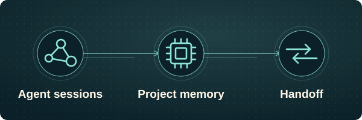
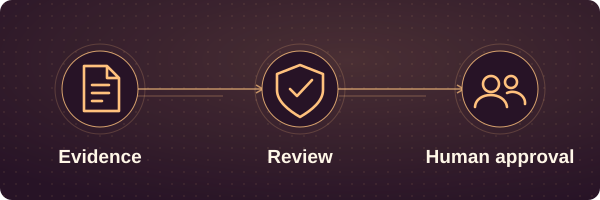
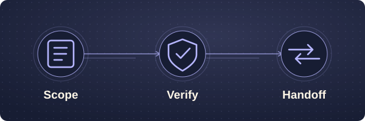
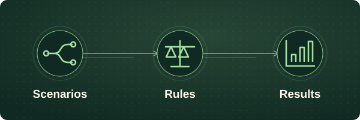
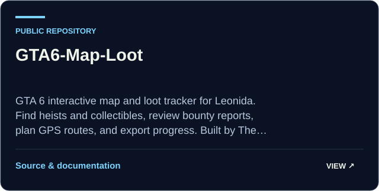

<h1 align="center"></h1>

I build business software in C# and .NET, automate workflows with Python, and make tools for coding agents. My projects range from tracing a vendor decision back to its evidence to helping a player find one missing collectible on a map of Leonida.

[Featured projects](#featured-projects) · [npm downloads](#npm-downloads) · [All repositories](#public-repositories) · [Languages & tools](#languages--tools) · [Contact](#websites--contact) · [LinkedIn](https://www.linkedin.com/in/ihtishamdeveloper/)

## Featured projects

<table>
<tr>
<td width="50%" valign="top">

<h3><a href="https://github.com/theihtishaam/agents-brain">Agent Shadow Brain</a></h3>

Pick up a project in another coding tool with its saved decisions, sources, and next step.

<a href="https://raw.githubusercontent.com/theihtishaam/agents-brain/v7.25.0/docs/assets/7.25.0-agent-traffic.gif">Brain Hub recording</a>

</td>
<td width="50%" valign="top">

<h3><a href="https://github.com/theihtishaam/Procure-guard-ai">ProcureGuard AI</a></h3>

Eight specialist agents review vendor evidence before a human signs off. Team Purrwolf won <b>Best Use of AI/ML API</b> at the 2026 Band of Agents Hackathon.

<a href="https://youtu.be/KhKxOJJEYho">Watch the demo</a> · <a href="https://www.linkedin.com/posts/lablab-ai_meet-the-ai-that-can-veto-its-own-approval-activity-7487495363164233728-iQSx">Award</a>

</td>
</tr>
<tr>
<td width="50%" valign="top">

<h3><a href="https://github.com/theihtishaam/GTA-6-Interactive-Map-and-Loot-Tracker">GTA 6 Loot Map</a></h3>

Pick a collectible, plan a route across Leonida, and keep an offline checklist. The atlas includes <b>176 mission entries</b> and 88 mission start waypoints.

<a href="https://raw.githubusercontent.com/theihtishaam/GTA-6-Interactive-Map-and-Loot-Tracker/v0.1.3/docs/quickstart/reward-map.webp">View the atlas</a> · <a href="https://github.com/theihtishaam/GTA-6-Interactive-Map-and-Loot-Tracker#readme">Player guide</a>

</td>
<td width="50%" valign="top">

<h3><a href="https://github.com/theihtishaam/omni-skills-forge">Omni Skills Forge</a></h3>

Find a skill for the project you have open. Switch a whole category on or off, or combine a few relevant files into one workspace skill.

<a href="https://github.com/theihtishaam/omni-skills-forge#open-it-in-your-project">Dashboard guide</a> · <a href="https://www.npmjs.com/package/omni-skills-forge">npm</a>

</td>
</tr>
<tr>
<td width="50%" valign="top">

<h3><a href="https://github.com/theihtishaam/exactwork-skills">ExactWork Skills</a></h3>

Six portable skills for research, review, context, handoff, learning, and delivery. Pick the ones that fit a project.

<a href="./docs/projects/exactwork-skills.md">How the skills fit together</a>

</td>
<td width="50%" valign="top">

<h3><a href="https://github.com/theihtishaam/CiviTwin">CivicTwin Δ</a></h3>

An enterprise tax and regulatory planning prototype. Change an assumption and trace which rules and outcomes change with it.

<a href="./docs/projects/civic-twin.md">Illustrated case study</a>

</td>
</tr>
</table>

**Omni Skills Forge catalog**

<!-- AUTO_OMNI_CATALOG_START -->
**50,009 skill files · 28 categories.** [Catalog counts](https://github.com/theihtishaam/omni-skills-forge/blob/main/docs/catalog-stats.json).
<!-- AUTO_OMNI_CATALOG_END -->

## npm downloads

<!-- AUTO_NPM_PACKAGES_START -->
| ✨ Project | 📥 Live total downloads | 📅 Snapshot through | 🔗 Explore |
|:--|:--|:--|:--|
| [**🧠 Agent Shadow Brain**](https://www.npmjs.com/package/@theihtisham/agent-shadow-brain) Persistent shared memory for AI agents |  | 2026-11-20 | [npm ↗](https://www.npmjs.com/package/@theihtisham/agent-shadow-brain) · [GitHub ↗](https://github.com/theihtishaam/agents-brain) |
| [**🛠️ ExactWork Skills**](https://www.npmjs.com/package/@theihtisham/exactwork-skills) Portable skills for coding agents |  | 2026-11-20 | [npm ↗](https://www.npmjs.com/package/@theihtisham/exactwork-skills) · [GitHub ↗](https://github.com/theihtishaam/exactwork-skills) |
| [**🧩 Omni Skills Forge**](https://www.npmjs.com/package/omni-skills-forge) Discover and install agent skills |  | 2026-11-20 | [npm ↗](https://www.npmjs.com/package/omni-skills-forge) · [GitHub ↗](https://github.com/theihtishaam/omni-skills-forge) |
<!-- AUTO_NPM_PACKAGES_END -->

The badges show all-time package downloads. npm and Shields cache their totals.

## Public repositories

<!-- AUTO_PUBLIC_PROJECTS_START -->
**8 public repositories · refreshed 2026-11-21**

<table>
<tr>
<td width="50%" valign="top"> <a href="https://github.com/theihtishaam/agents-brain"><b>Agent Shadow Brain</b> ↗</a></td>
<td width="50%" valign="top"> <a href="https://github.com/theihtishaam/Procure-guard-ai"><b>ProcureGuard AI</b> ↗</a></td>
</tr>
<tr>
<td width="50%" valign="top"> <a href="https://github.com/theihtishaam/exactwork-skills"><b>ExactWork Skills</b> ↗</a> · ★ 2</td>
<td width="50%" valign="top"> <a href="https://github.com/theihtishaam/GTA-6-Interactive-Map-and-Loot-Tracker"><b>GTA 6 Loot Map</b> ↗</a></td>
</tr>
<tr>
<td width="50%" valign="top"> <a href="https://github.com/theihtishaam/CiviTwin"><b>CivicTwin Δ</b> ↗</a></td>
<td width="50%" valign="top"> <a href="https://github.com/theihtishaam/omni-skills-forge"><b>Omni Skills Forge</b> ↗</a></td>
</tr>
<tr>
<td width="50%" valign="top"> <a href="https://github.com/theihtishaam/GTA6-Map-Loot"><b>GTA6-Map-Loot</b> ↗</a></td>
<td width="50%" valign="top"> <a href="https://github.com/theihtishaam/theihtishaam"><b>GitHub Profile</b> ↗</a></td>
</tr>
</table>

[Browse on GitHub](https://github.com/theihtishaam?tab=repositories) · [Project directory](./docs/PUBLIC_PROJECTS.md)
<!-- AUTO_PUBLIC_PROJECTS_END -->

### Latest repositories

<!-- AUTO_LATEST_REPOSITORIES_START -->
- <a href="https://github.com/theihtishaam/GTA-6-Interactive-Map-and-Loot-Tracker"><b>GTA 6 Loot Map</b></a> · Created 2026-11-21 — Plan a route across Leonida, find mission rewards, and keep an offline field journal.
- <a href="https://github.com/theihtishaam/GTA6-Map-Loot"><b>GTA6-Map-Loot</b></a> · Created 2026-11-21 — GTA 6 interactive map and loot tracker for Leonida. Find heists and collectibles, review bounty reports, plan GPS routes, and export…
- <a href="https://github.com/theihtishaam/omni-skills-forge"><b>Omni Skills Forge</b></a> · Created 2026-11-13 — Search, inspect, and copy Markdown coding-agent skills by category, tag, and difficulty.
<!-- AUTO_LATEST_REPOSITORIES_END -->

<!-- AUTO_RECEIVED_STARS_START -->
### Stars received

**2 total stars** across public repositories owned by [@theihtishaam](https://github.com/theihtishaam).

| Project | Stars |
|:--|--:|
| [exactwork-skills](https://github.com/theihtishaam/exactwork-skills) | 2 |
<!-- AUTO_RECEIVED_STARS_END -->

## Languages & tools

| What I build | Tools I use |
| --- | --- |
| Business applications and APIs | C#, .NET, ASP.NET MVC, WPF, REST |
| Web interfaces | TypeScript, JavaScript, Angular, React, HTML, CSS |
| Data and automation | Python, Flask, Pandas, NumPy, SQL Server, MySQL, PostgreSQL |
| Agent tools and deployment | Node.js, MCP, Git, GitHub Actions, Azure, AWS, IIS |

## Websites & contact

| Website | What you’ll find |
| --- | --- |
| [Ababil Technology](https://ababiltechnology.com/) | Business software and technology services |
| [Job Opportunity](https://jobopportunity.info/) | Jobs, scholarships, internships, and fellowships |
| [DealVorio](https://dealvorio.com/) | Deals, coupons, and learning offers |

[LinkedIn](https://www.linkedin.com/in/ihtishamdeveloper/) · [GitHub](https://github.com/theihtishaam) · [X](https://x.com/theihtishaam) · [Instagram](https://www.instagram.com/theihtishaam) · [npm](https://www.npmjs.com/~theihtisham) · [Email](mailto:Theihtisham@outlook.com)
