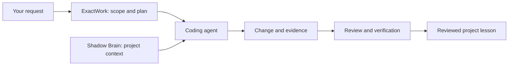

[**Projects**](#building-now) · [**Skills**](#what-i-work-with) · [**Résumé**](./RESUME.md) · [**LinkedIn**](https://www.linkedin.com/in/ihtishamdeveloper/) · [**Ababil Technology**](https://ababiltechnology.com/)

I’m **Ihtisham Ahmad**, a software engineer building business applications, web platforms, and tools for coding agents. I like making complicated work easier to understand—and easier to finish.

The photo refreshes from my GitHub profile. The scanner is a visual effect.

## Building now

**Agent Shadow Brain** connects coding tools to shared local knowledge. Review memories, assemble context for a task, and see recorded activity in a graphical workspace. The new project home is **[theihtishaam/agents-brain](https://github.com/theihtishaam/agents-brain)**.

[**Explore the project →**](https://github.com/theihtishaam/agents-brain#readme) · [Visual guide](https://github.com/theihtishaam/agents-brain/blob/main/docs/VISUAL_GUIDE_v7.1.4.md) · [npm package](https://www.npmjs.com/package/@theihtisham/agent-shadow-brain)

Recorded in the working portal with 74 imported sections from Agent Brain’s public documentation and actual local MCP calls. The graph shows stored records and document references.

**ExactWork Skills** gives an agent a practical working method: understand the request, research what matters, make the change, and check the result. Six Markdown skills cover **core work, research, review, handoff, context, and learning**. Install them for one project; the optional helpers use Python 3.10+.

[**Explore the skills →**](https://github.com/theihtishaam/exactwork-skills#readme) · [How they fit together](./docs/projects/exactwork-skills.md)

<b>Why these two projects belong together</b>

Agent Shadow Brain supplies the project memory and context workspace. ExactWork describes the working method an agent can follow. Each can be used independently; installing one does not automatically install or connect the other.

## More work

| Project | What it does | Explore |
|:--|:--|:--|
| **ProcureGuard AI** | Multi-agent procurement review with evidence, challenge, and human approval. **Best Use of AI/ML API**, 2026 Band of Agents Hackathon, Team Purrwolf. | [Code](https://github.com/theihtishaam/Procure-guard-ai) · [Demo video](https://youtu.be/KhKxOJJEYho) |
| **CivicTwin Δ** | Enterprise tax and regulatory scenario planning, with recorded rules and evidence. Public prototype. | [Code](https://github.com/theihtishaam/CiviTwin) · [Case study](./docs/projects/civic-twin.md) |
| **Job Opportunity** | Jobs, internships, scholarships, and fellowships in one public information platform. | [Website](https://jobopportunity.info/) |
| **DealVorio** | Deals, coupons, and learning offers with source information. | [Website](https://dealvorio.com/) |

<b>Hackathon recognition and project workflows</b>

[Organizer announcement](https://www.linkedin.com/posts/lablab-ai_meet-the-ai-that-can-veto-its-own-approval-activity-7487495363164233728-iQSx) · [ProcureGuard case study](./docs/projects/procureguard-ai.md)

## What I work with

[Engineering résumé](./RESUME.md) · [Experience and contact](https://www.linkedin.com/in/ihtishamdeveloper/)

## Open-source activity

Counts refresh daily from public sources. npm downloads are package download events, not unique users. [Sources and dates](./data/npm-metrics.json).

## Latest public projects

New public repositories on this account appear automatically after the next successful daily refresh. [Browse every project](./docs/PUBLIC_PROJECTS.md) · [Refresh workflow](./.github/workflows/profile.yml).

<!-- AUTO_PUBLIC_PROJECTS_START -->

<b>✦ AUTO-SYNC PROJECT INDEX · LAST VERIFIED 2026-11-13</b>

**Official public projects — [@theihtishaam](https://github.com/theihtishaam?tab=repositories)**

- **[Procure-guard-ai](https://github.com/theihtishaam/Procure-guard-ai)** — Python · Red team Ai System
- **[CiviTwin](https://github.com/theihtishaam/CiviTwin)** — TypeScript · Enterprise Tax Calculation system
- **[agents-brain](https://github.com/theihtishaam/agents-brain)** — TypeScript · Shared local memory and a live graphical workspace for coding agents. PDF knowledge, scoped context, MCP collaboration, project ski…
- **[exactwork-skills](https://github.com/theihtishaam/exactwork-skills)** — Python · Portable AI agent skills for Claude Code, Codex, OpenCode and DeepSeek Harness. Focused execution, traceable context, and evidence-…

[**Browse the complete public project directory**](./docs/PUBLIC_PROJECTS.md)

<!-- AUTO_PUBLIC_PROJECTS_END -->

---

**Have something useful to build?** [Find me on LinkedIn](https://www.linkedin.com/in/ihtishamdeveloper/) or explore [Ababil Technology](https://ababiltechnology.com/).

This README uses GitHub-supported images, SVG animation and diagrams. The [portfolio source](./docs/index.html) also includes hover effects and interactive project browsing.
