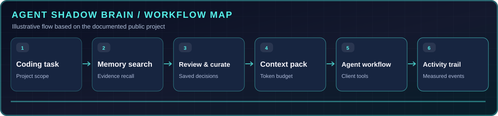
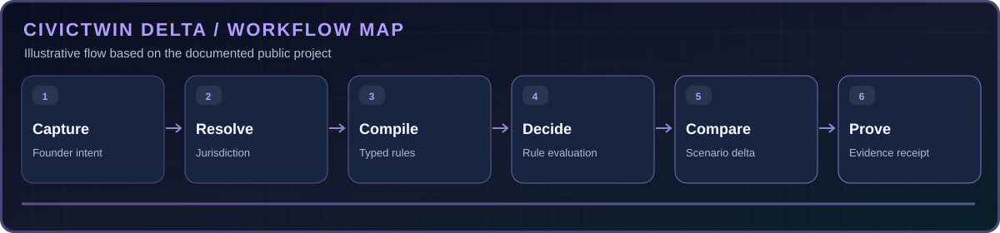
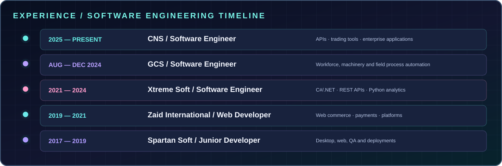

**Full-stack Software Engineer · C#/.NET · Python · TypeScript · AI Agents · Automation**

*I connect software, evidence and intelligent agents into practical engineering systems.*

[**Download evidence & reporting period**](https://github.com/ihtishaam-dev/agent-shadow-brain/blob/main/docs/STATS.md) · [Local count snapshot](./data/npm-metrics.json) · [npm package](https://www.npmjs.com/package/@theihtisham/agent-shadow-brain)

### 01. Agent Shadow Brain — memory for coding agents

Shared local memory and a visual workspace for reviewing decisions, building scoped context packs, integrating coding assistants, and inspecting tool activity.

**Stack:** TypeScript · Node.js · MCP · CLI · Local-first

[**Full project overview**](./docs/projects/agent-shadow-brain.md) · [**Source code**](https://github.com/ihtishaam-dev/agent-shadow-brain) · [**Release & demo**](https://github.com/ihtishaam-dev/agent-shadow-brain/releases/tag/v7.1.3) · [**npm**](https://www.npmjs.com/package/@theihtisham/agent-shadow-brain)

<b>View memory pipeline and real workspace images</b>

*The demo uses scripted local MCP clients and synthetic data.*

### 02. CivicTwin Δ — regulation with evidence

A scenario-based regulatory prototype that explains why a requirement applies, which business fact triggers it, and what changes when a founder's plan changes. Unverified values remain visibly unknown.

**Stack:** React · TypeScript · Tailwind · typed rules

[**Full project overview**](./docs/projects/civic-twin.md) · [**Source code**](https://github.com/ihtishaam-dev/Civic-Twins) · [**Demo prototype**](https://de2ryot975yrukt7xh4gymb1q.nativelyai.app/twin/)

<b>View CivicTwin's six-stage scenario workflow</b>

### 03. ProcureGuard AI — procurement decision room

An award-winning multi-agent review workspace. Specialist roles inspect procurement, security, finance, vendor and legal evidence; an adversarial red-team challenges the findings before a human decision gate.

**Stack:** Python · FastAPI · Band · LangGraph · CrewAI · Pydantic AI integrations

[**Full project overview**](./docs/projects/procureguard-ai.md) · [**Source code**](https://github.com/ihtishaam-dev/procureguard-ai-band-agents) · [**Recorded video**](https://youtu.be/KhKxOJJEYho)

<b>View agent approval workflow and real dashboard images</b>

<!-- AUTO_PUBLIC_PROJECTS_START -->

<b>✦ AUTO-SYNC PROJECT INDEX · LAST VERIFIED 2026-11-12</b>

**Official public projects — [@theihtishaam](https://github.com/theihtishaam?tab=repositories)**

New public repositories created under this account will automatically appear here after the next profile refresh.

**Featured open-source projects from previous account — [@ihtishaam-dev](https://github.com/ihtishaam-dev)**

- **[agent-shadow-brain](https://github.com/ihtishaam-dev/agent-shadow-brain)** — TypeScript · Shared local memory and a live activity portal for coding agents. Curated context, MCP, skills, graphs, and review tools.
- **[Civic-Twins](https://github.com/ihtishaam-dev/Civic-Twins)** — TypeScript · Public software project
- **[procureguard-ai-band-agents](https://github.com/ihtishaam-dev/procureguard-ai-band-agents)** — Python · Multi-agent enterprise procurement approval on the Band platform - Band of Agents Hackathon Track 1

[**Browse the complete public project directory**](./docs/PUBLIC_PROJECTS.md)

<!-- AUTO_PUBLIC_PROJECTS_END -->

[**Every public project**](./docs/PUBLIC_PROJECTS.md) · [**Source and metrics**](./data/github-stats.json) · [**Auto-refresh workflow**](./.github/workflows/profile.yml)

**THE IMMERSIVE WEB EXPERIENCE**

The GitHub profile README is a visual showcase. The full black spider-web background, cursor-reactive nodes, hover animations, and project interactivity run in the **same repository's GitHub Pages portfolio**: [**Site source**](./docs/index.html) · [**Enable or open GitHub Pages**](./docs/ENABLE_PAGES.md).

*GitHub.com controls its own surrounding page background and sidebar. A README cannot override those elements or run cursor-tracking JavaScript for other visitors.*

*Three featured project source repositories currently remain under [@ihtishaam-dev](https://github.com/ihtishaam-dev); these case studies link to them rather than claiming they were transferred.*

