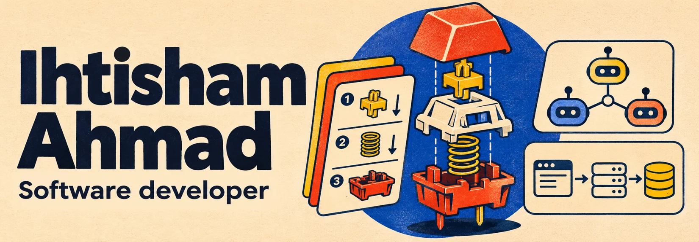
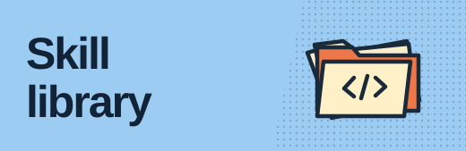
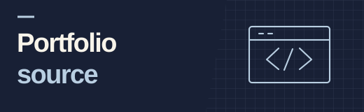
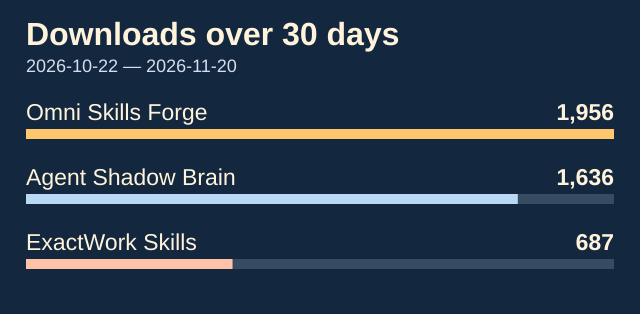
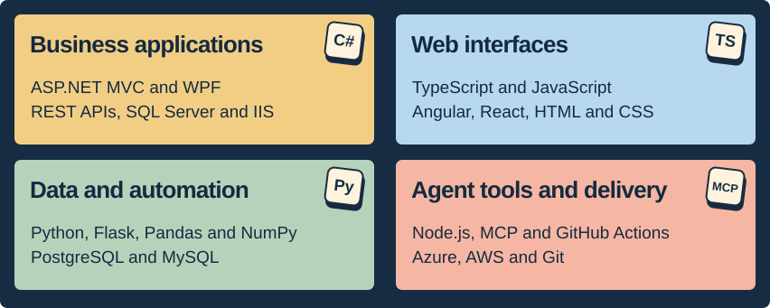
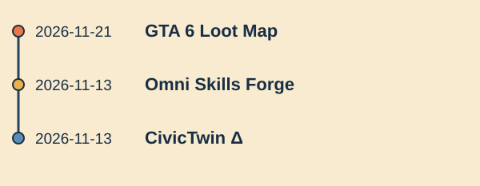

<h1></h1>

I write business software in **C# and .NET**, build web interfaces, and automate work with **Python**. Here you can explore the tools I build for coding agents, see how my team reviews procurement evidence, or plan a route through Leonida in my game atlas.

[Projects](#public-repositories) · [Packages on npm](#npm-downloads) · [Languages and tools](#languages--tools) · [Websites](#websites) · [Contact](#contact)

## Public repositories

<!-- AUTO_PUBLIC_PROJECTS_START -->
<table>
<tr>
<td width="50%" valign="top">

<h3><a href="https://github.com/theihtishaam/agents-brain">Agent Shadow Brain</a></h3>

Save a decision or a handoff in one coding tool and pick it up in another. The Brain Hub shows recorded exchanges in the workspace.

TypeScript · <a href="https://raw.githubusercontent.com/theihtishaam/agents-brain/v7.25.0/docs/assets/7.25.0-agent-traffic.gif">Watch the Brain Hub recording</a>

</td>
<td width="50%" valign="top">

<h3><a href="https://github.com/theihtishaam/Procure-guard-ai">ProcureGuard AI</a></h3>

Eight specialist agents check vendor evidence before human signoff. Team Purrwolf won Best Use of AI/ML API at the 2026 Band of Agents Hackathon.

Python · <a href="https://youtu.be/KhKxOJJEYho">Watch the demo</a> · <a href="https://www.linkedin.com/posts/lablab-ai_meet-the-ai-that-can-veto-its-own-approval-activity-7487495363164233728-iQSx">Award announcement</a>

</td>
</tr>
<tr>
<td width="50%" valign="top">

<h3><a href="https://github.com/theihtishaam/exactwork-skills">ExactWork Skills</a> · ★ 2</h3>

Six portable skills for execution, research, review, handoff, context, and learning. Choose the instructions a project needs.

Python · <a href="./docs/projects/exactwork-skills.md">Explore the six skills</a>

</td>
<td width="50%" valign="top">

<h3><a href="https://github.com/theihtishaam/GTA-6-Interactive-Map-and-Loot-Tracker">GTA 6 Loot Map</a></h3>

Choose a mission or collectible, plot a route across Leonida, and keep an offline field journal.

Python · <a href="https://raw.githubusercontent.com/theihtishaam/GTA-6-Interactive-Map-and-Loot-Tracker/v0.1.3/docs/quickstart/reward-map.webp">See the atlas</a> · <a href="https://github.com/theihtishaam/GTA-6-Interactive-Map-and-Loot-Tracker#readme">Player guide</a>

</td>
</tr>
<tr>
<td width="50%" valign="top">

<h3><a href="https://github.com/theihtishaam/omni-skills-forge">Omni Skills Forge</a></h3>

Find relevant guidance in a workspace, switch skills on or off, and combine a few files into one project skill.

JavaScript · <a href="https://github.com/theihtishaam/omni-skills-forge#open-it-in-your-project">Dashboard walkthrough</a>

</td>
<td width="50%" valign="top">

<h3><a href="https://github.com/theihtishaam/CiviTwin">CivicTwin Δ</a></h3>

Change an assumption in a tax scenario, then trace the rules, evidence, and results in this enterprise planning prototype.

TypeScript · <a href="./docs/projects/civic-twin.md">Read the case study</a>

</td>
</tr>
<tr>
<td colspan="2" valign="top">

<h3><a href="https://github.com/theihtishaam/theihtishaam">GitHub Profile</a></h3>

The artwork, repository index, and public-data tools behind this profile.

JavaScript

</td>
</tr>
</table>

7 public repositories · Updated 2026-11-21 · [Browse on GitHub](https://github.com/theihtishaam?tab=repositories) · [Project directory](./docs/PUBLIC_PROJECTS.md)
<!-- AUTO_PUBLIC_PROJECTS_END -->

## npm downloads

<!-- AUTO_NPM_PACKAGES_START -->

**All-time downloads**

<!-- AUTO_NPM_PACKAGES_END -->

The chart uses npm’s reported 30-day window. Each badge links to its package and shows a cached all-time total. [Download records](./data/npm-packages.json)

**Inside Omni Skills Forge**

<!-- AUTO_OMNI_CATALOG_START -->
**50,009 skill files · 28 categories.** [Catalog counts](https://github.com/theihtishaam/omni-skills-forge/blob/main/docs/catalog-stats.json).
<!-- AUTO_OMNI_CATALOG_END -->

## Languages & tools

<picture>
  <source media="(max-width: 600px)" srcset="./assets/folio/toolkit-mobile.svg">
  
</picture>

## Websites

- [**Ababil Technology**](https://ababiltechnology.com/) builds business software and provides technology services.
- [**Job Opportunity**](https://jobopportunity.info/) brings jobs, internships, scholarships, and fellowships into one place.
- [**DealVorio**](https://dealvorio.com/) collects deals, coupons, and learning offers.

## Repository activity

<!-- AUTO_LATEST_REPOSITORIES_START -->

<a title="Created 2026-11-21 · Choose a mission or collectible, plot a route across Leonida, and keep an offline field journal." href="https://github.com/theihtishaam/GTA-6-Interactive-Map-and-Loot-Tracker">GTA 6 Loot Map</a> · <a title="Created 2026-11-13 · Find relevant guidance in a workspace, switch skills on or off, and combine a few files into one project skill." href="https://github.com/theihtishaam/omni-skills-forge">Omni Skills Forge</a> · <a title="Created 2026-11-13 · Change an assumption in a tax scenario, then trace the rules, evidence, and results in this enterprise planning prototype." href="https://github.com/theihtishaam/CiviTwin">CivicTwin Δ</a>
<!-- AUTO_LATEST_REPOSITORIES_END -->

<!-- AUTO_RECEIVED_STARS_START -->

<b>★ 2 total stars</b> &nbsp; <a href="https://github.com/theihtishaam/exactwork-skills">exactwork-skills</a> · ★ 2

<!-- AUTO_RECEIVED_STARS_END -->

## Contact

  
  
  
  
  
  

