

<a href="https://github.com/theihtishaam"></a>

<a href="https://github.com/theihtishaam">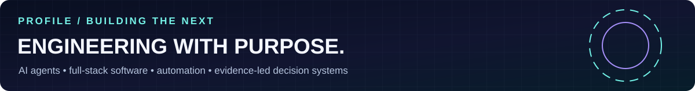</a>


<a href="https://www.linkedin.com/in/ihtishamdeveloper/">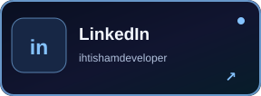</a>
<a href="https://www.npmjs.com/package/@theihtisham/agent-shadow-brain">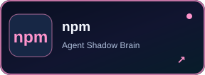</a>
<a href="https://ababiltechnology.com/">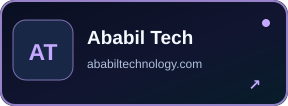</a>


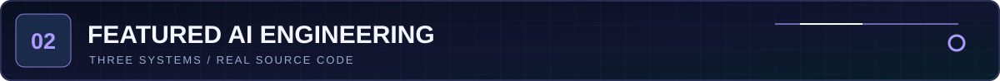

<a href="https://github.com/ihtishaam-dev/agent-shadow-brain"></a>
<a href="https://github.com/ihtishaam-dev/Civic-Twins"></a>
<a href="https://github.com/ihtishaam-dev/procureguard-ai-band-agents"></a>

**[Agent Shadow Brain](https://github.com/ihtishaam-dev/agent-shadow-brain)** · [npm package](https://www.npmjs.com/package/@theihtisham/agent-shadow-brain) &nbsp; | &nbsp; **[CivicTwin Δ](https://github.com/ihtishaam-dev/Civic-Twins)** · [Live prototype](https://de2ryot975yrukt7xh4gymb1q.nativelyai.app/twin/) &nbsp; | &nbsp; **[ProcureGuard AI](https://github.com/ihtishaam-dev/procureguard-ai-band-agents)** · [Demo video](https://youtu.be/KhKxOJJEYho)

<b>▶ Watch the Agent Shadow Brain live demonstration</b>

Recorded with scripted MCP clients and synthetic data.

<a href="https://ababiltechnology.com/"></a>
<a href="https://jobopportunity.info/"></a>
<a href="https://dealvorio.com/"></a>

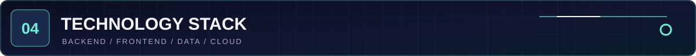

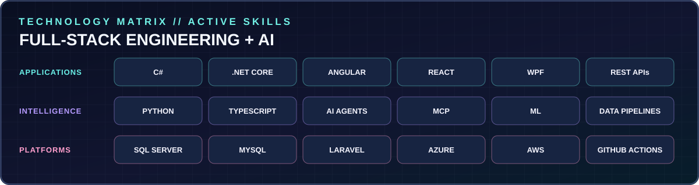

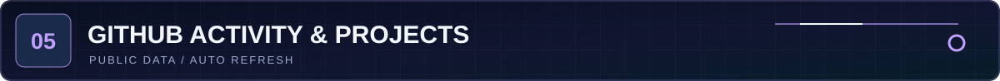

<a href="./data/github-stats.json">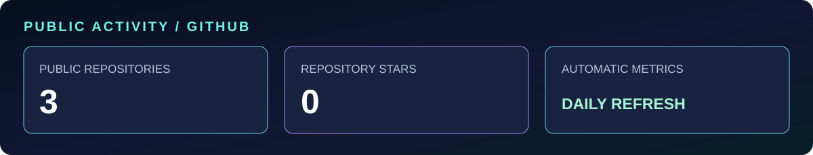</a>

<a href="./docs/PUBLIC_PROJECTS.md">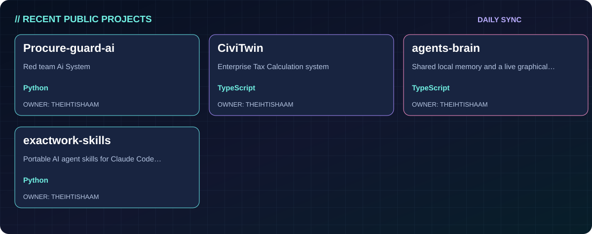</a>

**[Browse official public repositories](https://github.com/theihtishaam?tab=repositories)** · **[Browse all featured projects](./docs/PUBLIC_PROJECTS.md)** · **[See update automation](./.github/workflows/profile.yml)**

**Interactive portfolio with real mouse hover, cursor glow and 3D tilt:** [Open the complete source](./docs/index.html) · [Enable GitHub Pages](./docs/ENABLE_PAGES.md)

GitHub's surrounding interface, its light/dark setting and user-sidebar layout are controlled by GitHub, not by a README. These profile graphics use dark backgrounds and image animations. Interactive cursor effects run on the companion GitHub Pages website. The three featured source repositories currently live on @ihtishaam-dev; they have not yet been transferred.

