

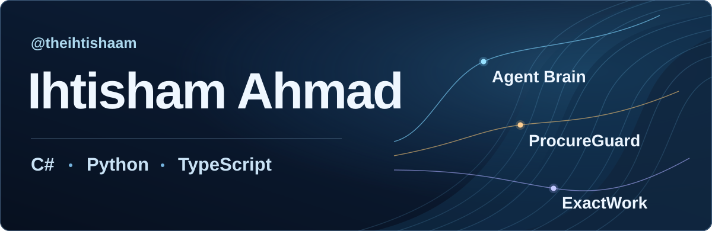

[**Featured projects**](#featured-projects) · [**Latest repositories**](#latest-repositories) · [**All repositories**](#public-repositories) · [**Popular on npm**](#popular-on-npm) · [**Languages & tools**](#languages--tools) · [**Websites**](#websites) · [**Connect**](#find-me-online)

I’m **Ihtisham Ahmad**. I build business applications with **C# and .NET**, web interfaces with **Angular and React**, and automation with **Python**. My open-source projects help coding agents use shared context, follow a practical working method, and produce results people can check.

My photo refreshes automatically from GitHub. The scanner is a decorative animation.

## Latest repositories

The three newest public repositories, ordered by the creation time reported by GitHub.

<!-- AUTO_LATEST_REPOSITORIES_START -->
- <a href="https://github.com/theihtishaam/omni-skills-forge"><b>Omni Skills Forge</b></a> · Created 2026-11-13 — Search, inspect, and copy Markdown coding-agent skills by category, tag, and difficulty.
- <a href="https://github.com/theihtishaam/CiviTwin"><b>CivicTwin Δ</b></a> · Created 2026-11-13 — Compare tax and regulatory scenarios with typed rules, recorded evidence, and explicit assumptions.
- <a href="https://github.com/theihtishaam/Procure-guard-ai"><b>ProcureGuard AI</b></a> · Created 2026-11-13 — Eight specialist agents, evidence, adversarial review, and human approval for vendor decisions.
<!-- AUTO_LATEST_REPOSITORIES_END -->

## Public repositories

Every public repository on this account appears below. New repositories join the grid after the next successful daily refresh.

<!-- AUTO_PUBLIC_PROJECTS_START -->
**6 public repositories · refreshed 2026-11-13**

<table>
<tr>
<td width="50%" valign="top"><a href="https://github.com/theihtishaam/agents-brain">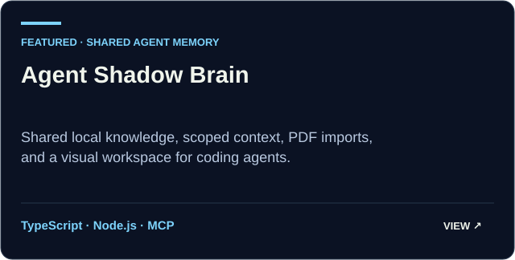</a> <a href="https://github.com/theihtishaam/agents-brain"><b>agents-brain</b> ↗</a></td>
<td width="50%" valign="top"><a href="https://github.com/theihtishaam/Procure-guard-ai">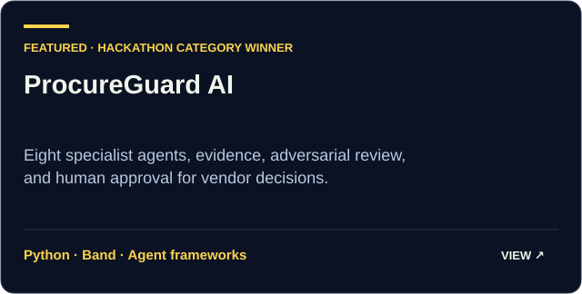</a> <a href="https://github.com/theihtishaam/Procure-guard-ai"><b>Procure-guard-ai</b> ↗</a></td>
</tr>
<tr>
<td width="50%" valign="top"><a href="https://github.com/theihtishaam/exactwork-skills">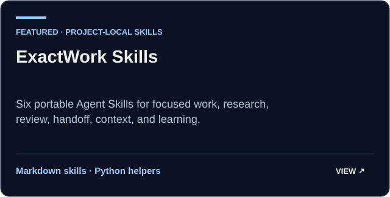</a> <a href="https://github.com/theihtishaam/exactwork-skills"><b>exactwork-skills</b> ↗</a></td>
<td width="50%" valign="top"><a href="https://github.com/theihtishaam/CiviTwin">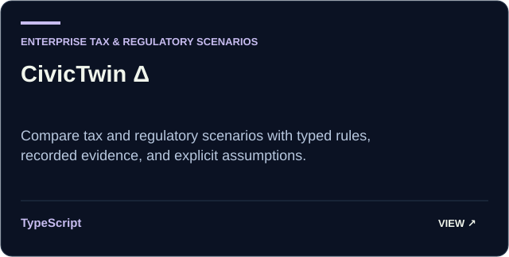</a> <a href="https://github.com/theihtishaam/CiviTwin"><b>CiviTwin</b> ↗</a></td>
</tr>
<tr>
<td width="50%" valign="top"><a href="https://github.com/theihtishaam/omni-skills-forge">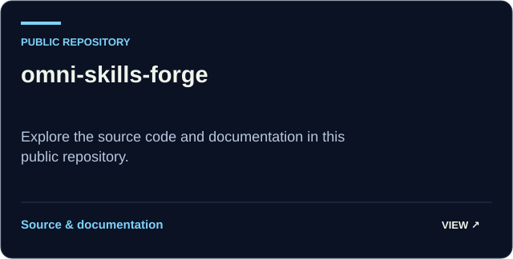</a> <a href="https://github.com/theihtishaam/omni-skills-forge"><b>omni-skills-forge</b> ↗</a></td>
<td width="50%" valign="top"><a href="https://github.com/theihtishaam/theihtishaam">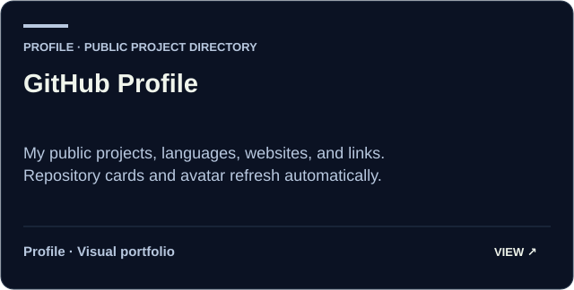</a> <a href="https://github.com/theihtishaam/theihtishaam"><b>theihtishaam</b> ↗</a></td>
</tr>
</table>

[Browse on GitHub](https://github.com/theihtishaam?tab=repositories) · [Project directory](./docs/PUBLIC_PROJECTS.md)
<!-- AUTO_PUBLIC_PROJECTS_END -->

## Featured projects

### Agent Shadow Brain · shared context for coding agents

<a href="https://github.com/theihtishaam/agents-brain">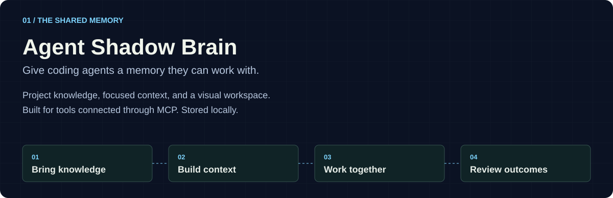</a>

Bring project knowledge into one local workspace. Import text or PDFs, review memories, assemble task context, and inspect stored relationships and recorded tool activity in a graphical portal. Workspace skills stay with their project.

**Useful for:** carrying relevant project context between coding tools through supported MCP integrations. Model identity and token usage appear only when the connected tool supplies them.

[**Open Agent Shadow Brain →**](https://github.com/theihtishaam/agents-brain#readme) · [Visual guide](https://github.com/theihtishaam/agents-brain/blob/main/docs/VISUAL_GUIDE_v7.1.4.md) · [npm package](https://www.npmjs.com/package/@theihtisham/agent-shadow-brain) · [Features and limits](https://github.com/theihtishaam/agents-brain/blob/main/docs/FEATURES_AND_LIMITS.md)

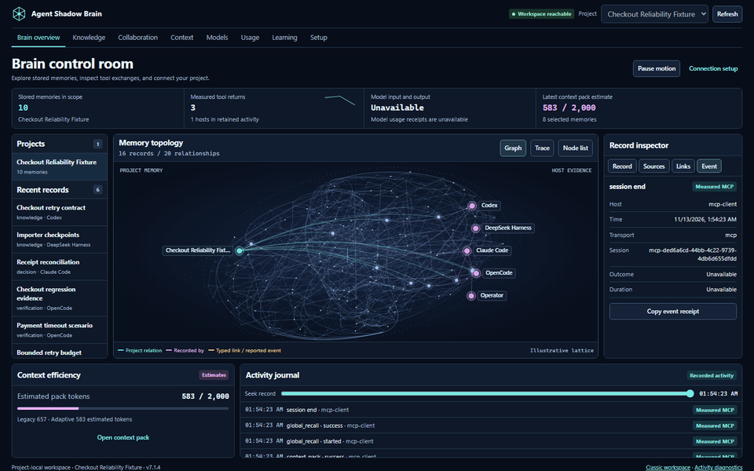

Recorded in the working portal with 74 imported sections from the project's public documentation and actual local MCP calls. This is an isolated documentation workspace.

### ProcureGuard AI · hackathon category winner

**Best Use of AI/ML API · 2026 Band of Agents Hackathon · Team Purrwolf.** ProcureGuard brings eight specialist agents into a vendor approval workspace. They share cited findings, challenge risky assumptions, and prepare an audit packet for human approval.

**Useful for:** making a procurement decision easier to inspect—from the first request to the evidence and final human signoff.

[**Open ProcureGuard AI →**](https://github.com/theihtishaam/Procure-guard-ai) · [Demo video](https://youtu.be/KhKxOJJEYho) · [Case study](./docs/projects/procureguard-ai.md) · [Organizer announcement](https://www.linkedin.com/posts/lablab-ai_meet-the-ai-that-can-veto-its-own-approval-activity-7487495363164233728-iQSx)

### ExactWork Skills · a practical method for agent work

Six Markdown Agent Skills cover **core work, research, review, handoff, context, and learning**. Install them in one project to give compatible coding agents a consistent working method. Optional helpers use Python 3.10+.

**Useful for:** keeping work scoped, research traceable, reviews concrete, and handoffs clear.

[**Open ExactWork Skills →**](https://github.com/theihtishaam/exactwork-skills#readme) · [How the skills fit together](./docs/projects/exactwork-skills.md)

### How Shadow Brain and ExactWork fit together

Shadow Brain provides the project memory and context workspace. ExactWork describes the method an agent can follow. They work independently; installing one does not automatically install or connect the other.

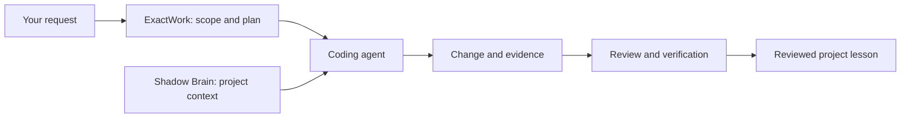

### CivicTwin Δ · tax and regulatory scenarios

An enterprise tax and regulatory scenario planning prototype that connects typed rules, evidence, and assumptions. Explore how different inputs affect a scenario and inspect the reasoning recorded with it.

[**Open CivicTwin →**](https://github.com/theihtishaam/CiviTwin) · [Illustrated case study](./docs/projects/civic-twin.md)

### Omni Skills Forge · Markdown skill catalog for coding agents

<a href="https://github.com/theihtishaam/omni-skills-forge">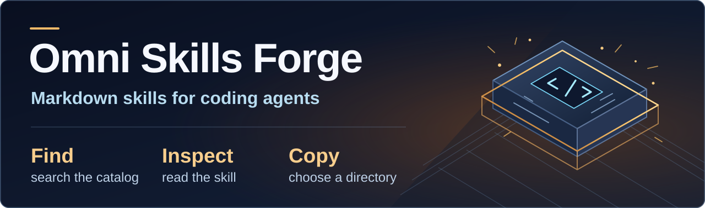</a>

Search by keyword, category, tag, or difficulty. Inspect the source and copy selected skills to an explicit directory. The CLI also generates a local catalog and exports the registry.

[**Open Omni Skills Forge →**](https://github.com/theihtishaam/omni-skills-forge) · [Category index](https://github.com/theihtishaam/omni-skills-forge/blob/main/docs/CATEGORIES.md) · [npm package](https://www.npmjs.com/package/omni-skills-forge)

## Languages & tools

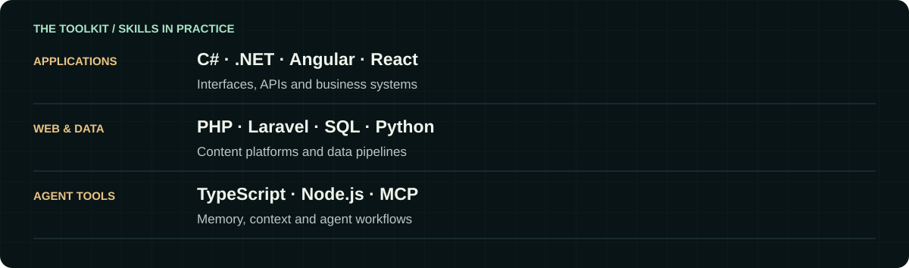

**Applications:** C# · .NET Core · ASP.NET MVC · WPF · REST APIs 
**Interfaces:** Angular · React · JavaScript · HTML · CSS 
**Data & automation:** Python · Flask · Pandas · NumPy · SQL Server · MySQL · PostgreSQL 
**Agent tooling:** TypeScript · Node.js · MCP · Git · GitHub Actions 
**Platforms:** Azure · AWS · IIS

## Websites

| [Ababil Technology](https://ababiltechnology.com/) | [Job Opportunity](https://jobopportunity.info/) | [DealVorio](https://dealvorio.com/) |
|:--:|:--:|:--:|
|  |  |  |
| Business technology and digital services | Jobs, scholarships, and fellowships | Deals, coupons, and learning offers |

## Find me online

|  |  |  |
|:--:|:--:|:--:|
| [LinkedIn](https://www.linkedin.com/in/ihtishamdeveloper/) | [X / Twitter](https://x.com/theihtishaam) | [Instagram](https://www.instagram.com/theihtishaam) |

[**Email me**](mailto:Theihtisham@outlook.com) · [GitHub](https://github.com/theihtishaam) · [npm package](https://www.npmjs.com/package/@theihtisham/agent-shadow-brain) · [Ababil Technology](https://ababiltechnology.com/)

## Open-source activity

<!-- AUTO_RECEIVED_STARS_START -->

<!-- AUTO_RECEIVED_STARS_END -->

## Popular on npm

<a href="./data/npm-metrics.json"></a>

<!-- AUTO_NPM_PACKAGES_START -->
<a href="https://www.npmjs.com/package/omni-skills-forge">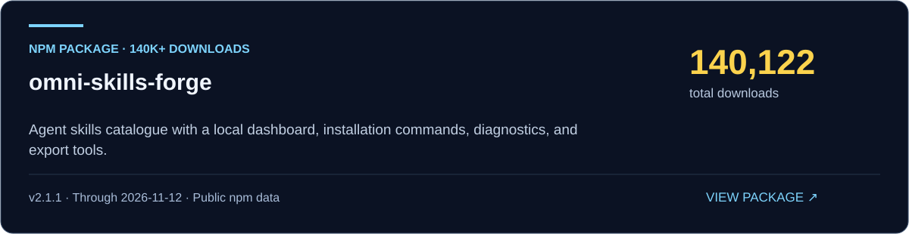</a>

[**omni-skills-forge →**](https://www.npmjs.com/package/omni-skills-forge) · **140,122 downloads** · 896 in the last 30 days · [GitHub repository](https://github.com/theihtishaam/omni-skills-forge)
<!-- AUTO_NPM_PACKAGES_END -->

Packages maintained by my npm account appear here automatically at 1,000 cumulative downloads. Counts refresh daily from public sources. npm downloads are package download events, not unique users. [Sources and dates](./data/npm-metrics.json) · [Refresh workflow](./.github/workflows/profile.yml).

---

**Have something useful to build?** [Find me on LinkedIn](https://www.linkedin.com/in/ihtishamdeveloper/) or [send an email](mailto:Theihtisham@outlook.com).
