**Software engineer building useful AI agents, full-stack platforms and practical automation.**

## ✦ Identity visualizer

  

  
  &nbsp; <strong>@theihtishaam</strong> &nbsp; • &nbsp; Live public avatar • the scanning animation is a visual effect, not biometric identification

## ✦ Featured AI engineering projects

  
  
  

| Project | What it delivers |
|:--|:--|
| **[Agent Shadow Brain](https://github.com/ihtishaam-dev/agent-shadow-brain)** | Shared local memory, decision trails and scoped context for AI coding agents. [npm package](https://www.npmjs.com/package/@theihtisham/agent-shadow-brain) |
| **[CivicTwin Δ](https://github.com/ihtishaam-dev/Civic-Twins)** | Evidence-led regulatory scenarios and enterprise tax planning prototype. |
| **[ProcureGuard AI](https://github.com/ihtishaam-dev/procureguard-ai-band-agents)** | Auditable vendor approval workflows with AI specialist review and human escalation. **2026 Band of Agents — Best Use of AI/ML API**. |

  
<b>▶ See Agent Shadow Brain in action</b>

  

  Demonstration uses scripted clients and synthetic data.

> These three project links currently point to the original public repositories. The new profile is the official landing page; [project migration instructions](./docs/MIGRATE_PROJECTS.md) explain how to move each repository with its Git history, without overwriting anything.

## ✦ Websites & live products

  
  
  

**[Ababil Technology](https://ababiltechnology.com/)** · Business and technology solutions  
**[Job Opportunity](https://jobopportunity.info/)** · Jobs, internships, fellowships and scholarships  
**[DealVorio](https://dealvorio.com/)** · Deals, coupons and learning offers

## ✦ Technology stack

## ✦ Live GitHub activity

### Automatically discovered public projects

**[Browse every public project](./docs/PUBLIC_PROJECTS.md)** · [View the live data](./data/public-projects.json) · [View automation](./.github/workflows/profile.yml)

Public repository data and the portrait inside the scan are refreshed daily by GitHub Actions. Featured projects are curated; the project list is automatic and includes newly created public repositories. If automatic updates are disabled in repository settings, the last generated snapshot remains visible.

---

  
  <b>Open to engineering, AI research and collaboration.</b>
  
<a href="https://www.linkedin.com/in/ihtishamdeveloper/">LinkedIn</a> • <a href="https://github.com/theihtishaam?tab=repositories">GitHub repositories</a> • <a href="https://ababiltechnology.com/">Website</a>

  © Ihtisham Ahmad • @theihtishaam

