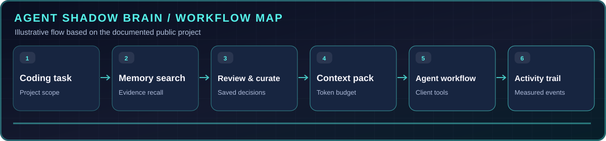

<div align="center">

[← Return to official GitHub profile](../../README.md) · [Browse all projects](../PUBLIC_PROJECTS.md)



**Curated memory, scoped context packs and a live operations portal for agent workflows.**

[Source code](https://github.com/ihtishaam-dev/agent-shadow-brain) · [Watch recorded demo](https://github.com/ihtishaam-dev/agent-shadow-brain/releases/tag/v7.1.3) · [Documentation](https://github.com/ihtishaam-dev/agent-shadow-brain/tree/main/docs)

</div>

## What problem does it solve?

Curated memory, scoped context packs and a live operations portal for agent workflows. The project is documented and published in its [source repository](https://github.com/ihtishaam-dev/agent-shadow-brain), which remains the authoritative reference for its latest behavior and setup.

## What it includes

- Search and review locally stored coding decisions and lessons.
- Build project-scoped context packs within a token budget.
- Inspect context selection, memory relationships, agent activity, and integrations.
- Install workflow skill files for supported coding clients.

## How it works



This is an illustrated overview of the documented workflow, not a live system measurement.

## Interface gallery

These are images published in the project source repository.

| Workspace view | Detailed view |
|:--:|:--:|
|  |  |

## Technology

TypeScript · Node.js · MCP · Local workspace / CLI

## Getting started

For full setup and configuration, use the project's [official README](https://github.com/ihtishaam-dev/agent-shadow-brain#readme). A short starting point from the project documentation is:

```bash
npm install -g @theihtisham/agent-shadow-brain@7.1.3
```

## Notes and boundaries

The product's public demo uses scripted local MCP clients and synthetic project data.

**Ownership:** Project code remains under `ihtishaam-dev`; this case study is hosted in the official `theihtishaam` profile repository. No transfer of Git history has been completed.

---

[View source](https://github.com/ihtishaam-dev/agent-shadow-brain) · [Watch recorded demo](https://github.com/ihtishaam-dev/agent-shadow-brain/releases/tag/v7.1.3) · [Back to profile](../../README.md)
