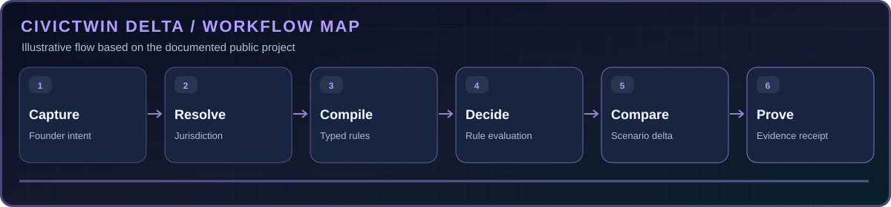

<div align="center">

[← Return to official GitHub profile](../../README.md) · [Browse all projects](../PUBLIC_PROJECTS.md)



**A source-aware regulatory scenario model that surfaces rules, deltas and unknowns.**

[Source code](https://github.com/ihtishaam-dev/Civic-Twins) · [Open public prototype](https://de2ryot975yrukt7xh4gymb1q.nativelyai.app/twin/) · [Documentation](https://github.com/ihtishaam-dev/Civic-Twins/blob/main/README.md)

</div>

## What problem does it solve?

A source-aware regulatory scenario model that surfaces rules, deltas and unknowns. The project is documented and published in its [source repository](https://github.com/ihtishaam-dev/Civic-Twins), which remains the authoritative reference for its latest behavior and setup.

## What it includes

- Turn founder descriptions into structured business scenario facts.
- Evaluate documented conditions and compare a baseline with a changed choice.
- Label unknown or assumption-dependent values instead of fabricating an answer.
- Generate proof receipts with rule triggers and source metadata.

## How it works



This is an illustrated overview of the documented workflow, not a live system measurement.

## Try the demo

The public project README links to an interactive prototype. A screenshot has not been copied into this case study because the source repository does not contain a verified product screenshot at the inspected commit.

## Technology

React · TypeScript · Vite · Tailwind CSS · Typed rule evaluation

## Getting started

For full setup and configuration, use the project's [official README](https://github.com/ihtishaam-dev/Civic-Twins#readme). A short starting point from the project documentation is:

```bash
npm install && npm run dev
```

## Notes and boundaries

This is a prototype and not an authoritative legal compliance service.

**Ownership:** Project code remains under `ihtishaam-dev`; this case study is hosted in the official `theihtishaam` profile repository. No transfer of Git history has been completed.

---

[View source](https://github.com/ihtishaam-dev/Civic-Twins) · [Open public prototype](https://de2ryot975yrukt7xh4gymb1q.nativelyai.app/twin/) · [Back to profile](../../README.md)
