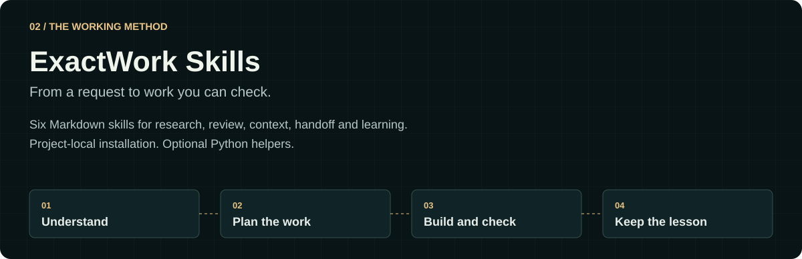

# ExactWork Skills

[Back to profile](../../README.md) · [Source and installation](https://github.com/theihtishaam/exactwork-skills)

Six Markdown Agent Skills guide a coding agent through useful, scoped work:

| Skill | Purpose |
| --- | --- |
| exactwork | Understand, plan, execute and verify |
| exactwork-research | Find evidence for the decision at hand |
| exactwork-review | Review changes and identify actionable issues |
| exactwork-handoff | Pass the relevant state to the next worker |
| exactwork-context | Keep context focused on the task |
| exactwork-learn | Record project-local procedures from reviewed outcomes |

The optional installation helpers require Python 3.10+. Preview a project-local install before applying it. See the source README for supported clients and exact commands.

Learning records project procedures; it does not train model weights or run an autonomous background learner. The repository publishes a small synthetic benchmark with its limitations; its results are not a general promise of token savings.
