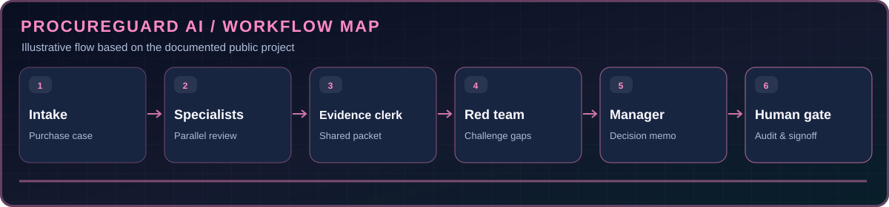

<div align="center">

[← Return to official GitHub profile](../../README.md) · [Browse all projects](../PUBLIC_PROJECTS.md)



**Vendor diligence across specialist agents, red-team challenges and human approval.**

[Source code](https://github.com/theihtishaam/Procure-guard-ai) · [Watch demo video](https://youtu.be/KhKxOJJEYho) · [Documentation](https://github.com/theihtishaam/Procure-guard-ai/tree/main/docs)

</div>

## What problem does it solve?

Vendor diligence across specialist agents, red-team challenges and human approval. The project is documented and published in its [source repository](https://github.com/theihtishaam/Procure-guard-ai), which remains the authoritative reference for its latest behavior and setup.

## What it includes

- Create shared vendor review rooms and role-assigned due diligence.
- Gather finance, security, legal and vendor findings with evidence references.
- Challenge decisions through adversarial red-team review.
- Export a decision packet with a human signoff gate and SHA-256 audit seal.

## How it works



This is an illustrated overview of the documented workflow, not a live system measurement.

## Interface gallery

These are images published in the project source repository.

| Workspace view | Detailed view |
|:--:|:--:|
|  |  |

## Technology

Python · FastAPI · Band SDK · LangGraph / CrewAI / Pydantic AI integrations

## Getting started

For full setup and configuration, use the project's [official README](https://github.com/theihtishaam/Procure-guard-ai#readme). A short starting point from the project documentation is:

```bash
uv sync && uv run python -m app.main
```

## Notes and boundaries

The application documents local simulated runs alongside separately identified live Band runs. Demonstration artifacts are not assurances of third-party compliance.

**Ownership:** The project has been copied to `theihtishaam` with its original commit history preserved.

---

[View source](https://github.com/theihtishaam/Procure-guard-ai) · [Watch demo video](https://youtu.be/KhKxOJJEYho) · [Back to profile](../../README.md)
